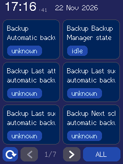
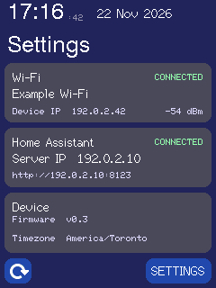

# FNK_HA

FNK_HA turns a **Freenove FNK0104B 2.8-inch ESP32-S3 touch display** into a local Home Assistant controller. The grid shows up to six tiles per page, with two-line names and separate status badges. The Settings view shows network and firmware details directly on the display.

[Download v0.3](https://github.com/BelalQuamar/fnk-ha/releases/tag/v0.3) · [Set up Home Assistant](#connect-to-home-assistant) · [Use the display](#use-the-display)

| Device grid | Connection and device details |
| --- | --- |
|  |  |

Both screenshots were captured over USB from the Freenove display. The Settings screenshot uses example network names and addresses.

## Install v0.3

The release targets the **FNK0104B with a 240 × 320 ILI9341 display and 16 MB flash**. Connect the display with a USB data cable and close any serial monitor.

| Installation | Download | Flash address |
| --- | --- | --- |
| Fresh install | [Merged binary](https://github.com/BelalQuamar/fnk-ha/releases/download/v0.3/fnk-ha-v0.3-merged.bin) | `0x0` |
| Update an existing FNK_HA installation | [App-only binary](https://github.com/BelalQuamar/fnk-ha/releases/download/v0.3/fnk-ha-v0.3-app.bin) | `0x10000` |

The merged binary clears saved settings. The app-only binary preserves settings and requires the FNK_HA partition layout. The [release page](https://github.com/BelalQuamar/fnk-ha/releases/tag/v0.3) includes `INSTALL.md` and `SHA256SUMS.txt`. To check the downloaded binary, compare its output from `shasum -a 256 <filename>` with the corresponding entry in `SHA256SUMS.txt`.

Install esptool in a Python virtual environment:

    python -m pip install esptool==4.9.0

For a fresh install, run:

    python -m esptool --chip esp32s3 --port YOUR_USB_PORT --baud 460800 write_flash 0x0 fnk-ha-v0.3-merged.bin

For an update, run:

    python -m esptool --chip esp32s3 --port YOUR_USB_PORT --baud 460800 write_flash 0x10000 fnk-ha-v0.3-app.bin

Replace `YOUR_USB_PORT` with the display's serial port, such as `/dev/cu.usbmodem1101` on macOS, `/dev/ttyACM0` on Linux, or `COM5` on Windows.

## Connect to Home Assistant

1. Open Home Assistant using its LAN IP and port, such as `http://192.168.1.10:8123`. Choose an address reachable from the display's 2.4 GHz Wi-Fi network. Use a trusted LAN because HTTP sends the token in plaintext.
2. In your Home Assistant profile, open **Security** and create a **Long-lived access token**.
3. Clone this repository or extract the source archive from the release. From that directory, run the USB setup tool with the display connected.

       python -m pip install pyserial==3.5
       python tools/configure.py --port YOUR_USB_PORT

4. Enter the Wi-Fi details, Home Assistant URL, and token when prompted. After the tool reports **Saved on ESP32**, the board restarts and loads the entity list.

## Use the display

Tap the bottom-right view selector to cycle through **Controls**, **All**, **Favorites**, and **Settings**.

| View | Tiles |
| --- | --- |
| **Controls** | Lights, switches, fans, humidifiers, and input booleans. This is the default view. |
| **All** | Every entity Home Assistant reports, including sensors. One physical device may have several entities. |
| **Favorites** | Your pinned entities in the order you set on the display. |
| **Settings** | Wi-Fi name, connection status, signal strength, device and server IP addresses, Home Assistant URL, firmware version, and timezone. |

- Tap a supported tile to turn it on or off. Its badge shows the reported state. Long names split across two lines, and each line scrolls if it still exceeds the tile width.
- Tap the larger arrows in the footer to change pages. The arrows and page count appear when the view has more than one page.
- Tap the circular arrow at the bottom left to refresh or check the connection. The entity list and states also refresh automatically every 60 seconds.

### Pin and reorder favorites

1. In **Controls** or **All**, hold a tile for about a second and release to pin it. A yellow dot marks the tile. Repeat the gesture in either view to unpin it.
2. In **Favorites**, hold and release a tile to move it to the front. To order a whole list, move the tiles in reverse order, finishing with the one you want first.

The selected view and favorite order survive restarts. The display sleeps after two minutes of inactivity. The first touch or BOOT press wakes it. If touch is unavailable, tap BOOT to move focus, hold it for about one second to activate, or hold it for at least 1.8 seconds for the favorite action.

The header shows the time and date in Home Assistant's configured timezone and adjusts for daylight saving time. Open **Settings** to see the timezone. Until Home Assistant supplies a timezone, the display uses its last known timezone for that server, or UTC on a fresh installation.

## Troubleshooting

| Display message | What to check |
| --- | --- |
| **DEMO** | Run USB setup and wait for the save confirmation. |
| **Wi-Fi offline** | Check the 2.4 GHz SSID, password, and signal. |
| **Home Assistant unreachable** | Open the LAN URL from the same network. Try the server's IP address if its hostname fails, and check guest Wi-Fi isolation or VLAN rules. |
| **HA token rejected** | Create a new Home Assistant token and rerun USB setup. |

If a refresh fails, the previous list stays visible with offline badges while the display retries.

## Build from source

In an activated Python virtual environment, run:

    python -m pip install -r requirements-dev.txt
    pio run
    pio run -t upload --upload-port YOUR_USB_PORT

Successful [main-branch Actions runs](https://github.com/BelalQuamar/fnk-ha/actions/workflows/firmware.yml?query=branch%3Amain) also provide a `fnk-ha-dev` artifact with binaries under `dev/`.

Run the host checks for layout, sleep timing, and timezone:

    for test in tests/*_test.cpp; do
      c++ -std=c++11 -Iinclude "$test" -o /tmp/fnk-ha-test && /tmp/fnk-ha-test || exit 1
    done

The [board pin assignments](include/display_setup.h) are in the repository. Use `python tools/screenshot.py --help` for USB framebuffer captures. Firmware communicates with Home Assistant through its [REST API](https://developers.home-assistant.io/docs/api/rest/).
