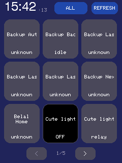
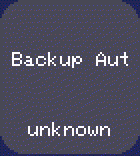

# FNK_HA

FNK_HA is a Home Assistant controller for the **Freenove FNK0104B 2.8-inch ESP32-S3 touch display**. It connects directly to Home Assistant over local Wi-Fi. The adaptive grid displays up to nine entities per page and refreshes automatically every 60 seconds.

The close-up below shows a long name scrolling on an actual entity tile.

## Install the firmware

These binaries are for the **Freenove FNK0104B 2.8-inch ILI9341 display with a 16 MB ESP32-S3**. Connect it to your computer with a USB data cable and close any open serial monitor.

### Latest firmware from main

Build and upload from a clone of this repository to get the **Controls**, **All**, and **Favorites** views and scrolling names. In an activated Python virtual environment, run:

    python -m pip install -r requirements-dev.txt
    pio run -t upload --upload-port YOUR_USB_PORT

Alternatively, open a successful [Firmware Actions run on main](https://github.com/BelalQuamar/fnk-ha/actions/workflows/firmware.yml?query=branch%3Amain), download its **fnk-ha-dev** artifact, and extract the binaries from `dev/`. Follow the flashing instructions below using the `fnk-ha-dev-merged.bin` or `fnk-ha-dev-app.bin` filename.

### Flash a prebuilt binary

The [v0.1 release](https://github.com/BelalQuamar/fnk-ha/releases/tag/v0.1) contains the original all-entity grid. The Actions artifact and the release both include flashing instructions and checksums. On macOS or Linux, run `shasum -a 256 -c SHA256SUMS.txt` from the directory containing the binaries.

| Use | Binary suffix | Flash address |
| --- | --- | --- |
| First installation | `-merged.bin` | `0x0` |
| Update an existing FNK_HA installation | `-app.bin` | `0x10000` |

The merged image replaces the existing firmware and clears saved settings. The app image requires the FNK_HA partition layout and preserves saved configuration. For example, to flash the merged binary from the latest Actions artifact, run:

    python -m pip install esptool==4.9.0
    python -m esptool --chip esp32s3 --port YOUR_USB_PORT --baud 460800 write_flash 0x0 fnk-ha-dev-merged.bin

For an app-only update, use `write_flash 0x10000 fnk-ha-dev-app.bin` in the same command. USB ports typically look like `/dev/cu.usbmodem1101` on macOS, `/dev/ttyACM0` on Linux, or `COM5` on Windows.

## Connect to Home Assistant

1. From a computer on your local network, open Home Assistant using its LAN IPv4 address and port, such as `http://192.168.1.10:8123`. Use an HTTP address reachable from the display's 2.4 GHz Wi-Fi network. HTTP sends the token in plaintext, so use a trusted LAN.
2. In Home Assistant, open your profile's **Security** tab and create a **Long-lived access token**.
3. Clone this repository or download and extract the source archive from the release. From the source directory, install the serial dependency and run setup with the display connected.

       python -m pip install pyserial==3.5
       python tools/configure.py --port YOUR_USB_PORT

4. Enter the Wi-Fi network name and password, the Home Assistant LAN URL, and the token. The setup script prompts for secrets without echoing them. When it reports **Saved on ESP32**, the board restarts and loads the entity list.

## Use the display

The compact header shows the time, view selector, and small **Refresh** button. Tap the view selector next to **Refresh** to cycle through **Controls**, **All**, and **Favorites**. Single-page views use the area below the header for larger tiles.

| Control | What it does |
| --- | --- |
| Entity tile | Toggles an available light, switch, fan, humidifier, or input boolean. Other tiles display their reported states. |
| **Controls** | The default view. Shows lights, switches, fans, humidifiers, and input booleans. |
| **All** | Shows all entities Home Assistant reports, including sensors. |
| **Favorites** | Shows the tiles you selected in your saved order. |
| **<** and **>** | Move between pages using the bottom bar. The bar appears only when the view needs more than one page. |
| **REFRESH** | Tap the small top-right button to reload the list and reported states immediately. |

Tiles use the Home Assistant friendly name. A device with a switch and a power sensor appears on two tiles. Longer names wrap or scroll within their tiles. The grid refreshes in the background every 60 seconds and picks up new, renamed, and removed entities.

### Pin and reorder favorites

1. In **Controls** or **All**, hold a tile for about a second, then release to pin it. A yellow dot marks pinned tiles. Repeat the gesture in **Controls** or **All** to remove a pin.
2. Switch to **Favorites**. Hold and release a tile to move it to the front. To arrange a whole list, move tiles in reverse order, finishing with the tile you want first.

The display saves both the active view and your favorite order across restarts.

After two minutes of inactivity, the display sleeps. A tap or BOOT press wakes it. If touch is unavailable, briefly press BOOT to move focus or hold it for at least 0.8 seconds to activate the focused tile or button. Hold for at least 1.8 seconds for the favorite action. The clock uses network time and defaults to Toronto.

## Troubleshooting

- **DEMO** means the board needs USB setup. Run the setup script and wait for the save confirmation.
- **Wi-Fi offline** means the board has lost its Wi-Fi connection. Check the 2.4 GHz SSID, password, and signal.
- **Home Assistant unreachable** means the board received no HTTP response. Verify the URL in a browser on the same LAN. Use the server's LAN IP if its hostname fails to resolve and check for guest Wi-Fi isolation or VLAN rules.
- **HA token rejected** means Home Assistant responded but refused authentication. Create a fresh token and rerun setup.
- When a refresh fails, the previous list remains visible with offline tiles. The display retries automatically.

## Development

To compile without uploading, run the following in an activated Python virtual environment:

    python -m pip install -r requirements-dev.txt
    pio run

Firmware uses the [Home Assistant REST API](https://developers.home-assistant.io/docs/api/rest/). The board's pin assignments are in [display_setup.h](include/display_setup.h). For USB framebuffer capture, run:

    python tools/screenshot.py --help

Run the host-side checks for layout, sleep timing, and timezone:

    for test in tests/*_test.cpp; do
      c++ -std=c++11 -Iinclude "$test" -o /tmp/fnk-ha-test && /tmp/fnk-ha-test || exit 1
    done
